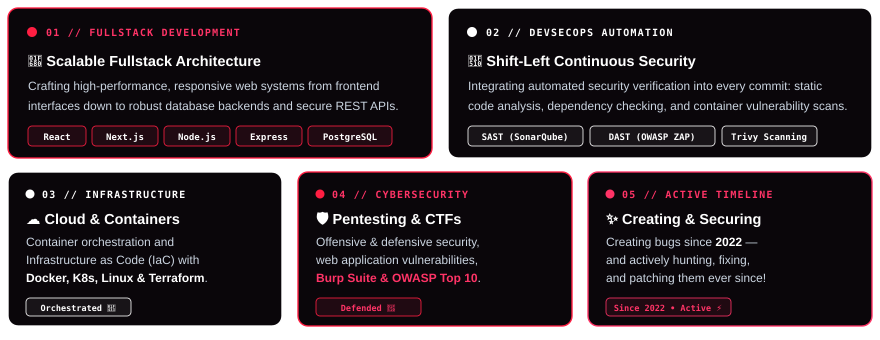
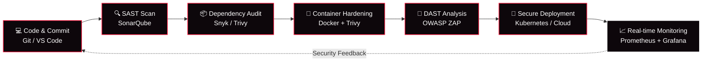

<div align="center">
  
</div>

<br/>

<p align="center">
  <a href="https://git.io/typing-svg">
    
  </a>
</p>

<p align="center">
  
  
  
  
</p>

---

## ⚡ `whoami` — Cyber Identity & Core Mission

```bash
┌──(rezza㉿redteam-secops)-[~]
└─$ cat /etc/security_profile.yml
```

```yaml
identity:  Rezza Fairus Nugraha (rezzafairus)
origin:    West Java, Indonesia 🇮🇩
mandate:   "Security is not a blocker — it is a foundational engineering pillar."
roles:
  - Fullstack Developer      # architecting resilient web applications from UI to database
  - DevSecOps Engineer       # automating security checks at every CI/CD stage (shift-left)
  - Cybersecurity Specialist # exploring offensive pentesting, OWASP Top 10 & defensive hardening
motto:     "Build it fast, ship it safe."
```

<br/>

<!-- ANIMATED CYBER MANIFESTO HUD -->
<div align="center">
  
</div>

<br/>

<!-- ANIMATED CYBER CAPABILITIES & DOMAINS MATRIX -->
<div align="center">
  
</div>

---

## 🛠️ Cyber Arsenal & Tech Stack

<div align="center">

### 💻 Fullstack & Modern Web


### 🗄️ Databases & Caching


### ⚙️ DevOps, DevSecOps & Cloud


### 🛡️ Cybersecurity, Pentesting & OS


<p>
  
  
  
  
  
  
  
  
</p>

### 🎨 Developer Tools


</div>

---

## 🔄 Automated Shift-Left DevSecOps Workflow



---

## 📊 Live Telemetry & GitHub Analytics

<div align="center">
  
  
</div>

<div align="center">
  
</div>

<div align="center">
  
</div>

---

## 🐍 Dynamic Contribution Grid Snake

<div align="center">
<picture>
  <source media="(prefers-color-scheme: dark)" srcset="https://raw.githubusercontent.com/rezzafairusnugraha/rezzafairusnugraha/output/github-contribution-grid-snake-dark.svg" />
  <source media="(prefers-color-scheme: light)" srcset="https://raw.githubusercontent.com/rezzafairusnugraha/rezzafairusnugraha/output/github-contribution-grid-snake.svg" />
  
</picture>
</div>

---

## 🌐 Connect With Me

<div align="center">
  <a href="https://www.linkedin.com/in/rezza-fairus-nugraha/" target="_blank">
    
  </a>
  &nbsp;
  <a href="https://github.com/rezzafairusnugraha" target="_blank">
    
  </a>
  &nbsp;
  <a href="mailto:rezzafairusnugrahaa@gmail.com">
    
  </a>
  &nbsp;
  <a href="https://www.instagram.com/rexzgraphic_" target="_blank">
    
  </a>
</div>

<br/>

<div align="center">

> *"Security is not a product, but a continuous process."* — **Bruce Schneier**


</div>
