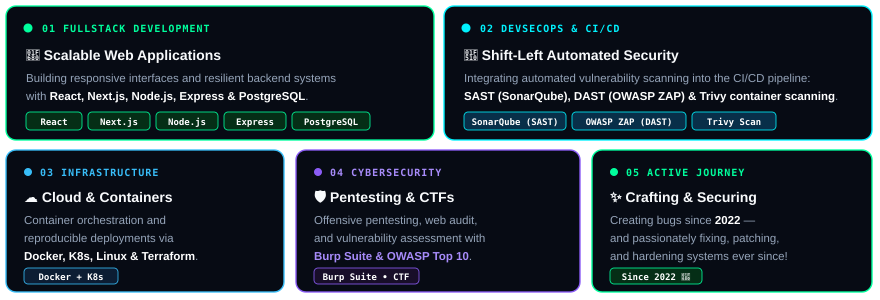
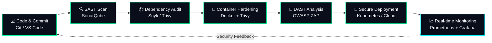

<div align="center">
  
</div>

<br/>

<p align="center">
  <a href="https://git.io/typing-svg">
    
  </a>
</p>

<p align="center">
  
  
  
  
</p>

---

## 🧑‍💻 About Me

```bash
┌──(rezza㉿github)-[~]
└─$ whoami
```

```yaml
name: Rezza Fairus Nugraha
location: West Java, Indonesia
roles:
  - Fullstack Developer
  - DevSecOps Engineer
  - Cybersecurity Specialist
motto: "Build it fast, ship it safe."
```

<div align="center">
  
</div>

<br/>

<div align="center">
  
</div>

---

## 🛠️ Tech Stack & Arsenal

<div align="center">

### 💻 Fullstack Development


### 🗄️ Databases & Caching


### ⚙️ DevOps & DevSecOps


### 🛡️ Cybersecurity, Pentesting & OS


### 🎨 Developer Tools


</div>

---

## 🔄 Automated Shift-Left DevSecOps Workflow



---

## 📊 Live Telemetry & GitHub Analytics
<div align="center">
  
</div>

## 🐍 Contribution Snake

<div align="center">
<picture>
  <source media="(prefers-color-scheme: dark)" srcset="https://raw.githubusercontent.com/rezzafairusnugraha/rezzafairusnugraha/output/github-contribution-grid-snake-dark.svg" />
  <source media="(prefers-color-scheme: light)" srcset="https://raw.githubusercontent.com/rezzafairusnugraha/rezzafairusnugraha/output/github-contribution-grid-snake.svg" />
  
</picture>
</div>

---

## 🌐 Connect With Me

<div align="center">
  <a href="https://www.linkedin.com/in/rezza-fairus-nugraha/" target="_blank">
    
  </a>
  &nbsp;
  <a href="https://github.com/rezzafairusnugraha" target="_blank">
    
  </a>
  &nbsp;
  <a href="https://www.tiktok.com/@rezzafairusnugraha" target="_blank">
    
  </a>
  &nbsp;
  <a href="mailto:rezzafairusnugrahaa@gmail.com">
    
  </a>
  &nbsp;
  <a href="https://www.instagram.com/rxzafaiirss" target="_blank">
    
  </a>
</div>

<br/>

<div align="center">

> *"Security is not a product, but a process."* — **Bruce Schneier**


</div>
