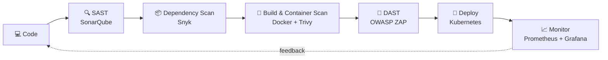

<!-- ===================== HEADER ===================== -->
<div align="center">


<a href="https://git.io/typing-svg">
  
</a>

<p>
  
  
  
</p>

</div>

---

## 🧑‍💻 About Me

```bash
┌──(rezza㉿github)-[~]
└─$ whoami
```

```yaml
name:      Rezza Fairus Nugraha
location:  West Java, Indonesia 🇮🇩
roles:
  - Fullstack Developer      # crafting web apps from UI to database
  - DevSecOps Engineer       # automating pipelines with security baked in
  - Cybersecurity Enthusiast # breaking things to make them stronger
motto:     "Build it fast, ship it safe."
```

I'm a developer who believes **great software must also be secure software**. I build end-to-end web applications, automate CI/CD pipelines with security integrated at every stage (*shift-left*), and explore offensive & defensive security to understand how systems break — and how to protect them.

- 🚀 **Building:** Scalable fullstack apps with **React, Next.js, Node.js & PostgreSQL**
- 🔐 **Securing:** CI/CD pipelines with SAST, DAST, dependency & container scanning
- ☁️ **Exploring:** Docker, Kubernetes, Infrastructure as Code & cloud security
- 🛡️ **Hacking (ethically):** Web app pentesting, CTFs, and OWASP Top 10
- ✨ **Creating bugs since:** 2022 — and fixing them ever since
- 🎲 **Fun fact:** I once spent 12 hours hunting a bug that turned out to be a missing semicolon 😅

---

## 🛠️ Tech Stack

<div align="center">

### 💻 Fullstack Development


### 🗄️ Databases


### ⚙️ DevOps & DevSecOps


### 🛡️ Cybersecurity & OS


<p>
  
  
  
  
  
  
  
  
</p>

### 🎨 Tools


</div>

---

## 🔄 My DevSecOps Workflow



---

## 📊 GitHub Stats

<div align="center">


</div>

---

## 🐍 Contribution Snake

<div align="center">
<picture>
  <source media="(prefers-color-scheme: dark)" srcset="https://raw.githubusercontent.com/rezzafairusnugraha/rezzafairusnugraha/output/github-contribution-grid-snake-dark.svg" />
  <source media="(prefers-color-scheme: light)" srcset="https://raw.githubusercontent.com/rezzafairusnugraha/rezzafairusnugraha/output/github-contribution-grid-snake.svg" />
  
</picture>
</div>

---

## 🌐 Connect With Me

<div align="center">

<a href="https://www.linkedin.com/in/rezza-fairus-nugraha/" target="_blank">
  
</a>
<a href="mailto:rezzafairusnugrahaa@gmail.com">
  
</a>
<a href="https://www.instagram.com/rexzgraphic_" target="_blank">
  
</a>
<a href="https://github.com/rezzafairusnugraha" target="_blank">
  
</a>

<br/><br/>

> *"Security is not a product, but a process."* — Bruce Schneier


</div>
